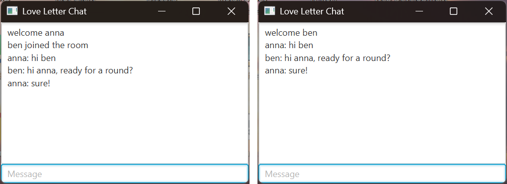
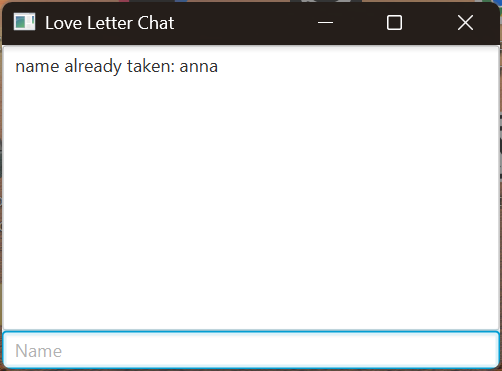
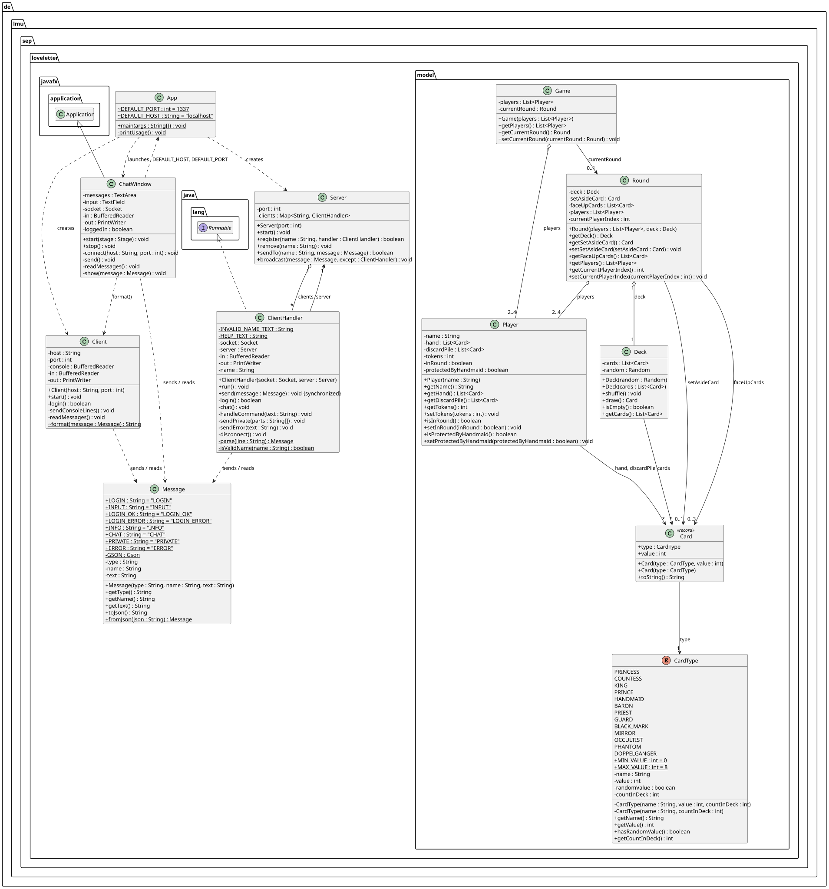

# Love Letter – Preliminary Project (SEP, LMU, Winter Term 2026/27)

Chat system over TCP: any number of clients log in to the server with a unique name and chat with
each other. Also includes the data model for Love Letter (2–4 players).

## Quick start

```powershell
mvn package
java -jar target/loveletter-jar-with-dependencies.jar server
java -jar target/loveletter-jar-with-dependencies.jar gui
java -jar target/loveletter-jar-with-dependencies.jar gui
```

Run each `java` command in its own terminal: one server, two chat windows. In each window, enter a
name, then chat.

## Requirements

- JDK 27 (`java -version` must show 27; otherwise set `JAVA_HOME` to a JDK 27)
- Maven 3.9 or newer
- JavaFX 27 does not need to be installed: Maven downloads it as the dependency
  `org.openjfx:javafx-controls` (the Maven approach from the openjfx docs), so no JavaFX SDK and no
  SDK path are needed.

## Build

```powershell
mvn package
```

Builds and tests the project. Result: `target/loveletter-jar-with-dependencies.jar` (contains Gson
and JavaFX for the operating system it was built on).

## Running

Server (default port 1337):

```powershell
java -jar target/loveletter-jar-with-dependencies.jar server
java -jar target/loveletter-jar-with-dependencies.jar server 4000
```

Client (default: `localhost`, port 1337), in a separate terminal per client:

```powershell
java -jar target/loveletter-jar-with-dependencies.jar client
java -jar target/loveletter-jar-with-dependencies.jar client localhost 4000
```

The client asks for a name. After that, every line entered is sent to everyone.
`bye` or `/bye` ends the connection.

Chat window (JavaFX, default: `localhost`, port 1337):

```powershell
java -jar target/loveletter-jar-with-dependencies.jar gui
java -jar target/loveletter-jar-with-dependencies.jar gui localhost 4000
```

First enter the name at the bottom and press Enter, then send each line with Enter – just like the
console client. The window uses the same server and the same protocol as the console client, so the
two can chat with each other. Closing the window ends the connection.



If the name is already taken, the field stays on name input:



Name rules: leading and trailing spaces are removed; the name must not be empty, must not contain
spaces and must not start with `/`. Names are case-sensitive (`anna` and `Anna` are different).

## VS Code

Requires the extension **Extension Pack for Java** (`vscjava.vscode-java-pack`); VS Code suggests it
when the folder is opened. The files in `.vscode/` contain machine-specific JDK paths and are
therefore not in Git (`.gitignore`):

| File              | Purpose                                                                                     |
|-------------------|---------------------------------------------------------------------------------------------|
| `settings.json`   | Java extension uses JDK 27; every new terminal gets `JAVA_HOME` and Java 27 on the `PATH`   |
| `extensions.json` | recommends the Extension Pack for Java                                                      |
| `tasks.json`      | tasks for building, testing and running (Ctrl+Shift+P → *Tasks: Run Task*)                  |
| `launch.json`     | debug configurations with breakpoints (Ctrl+Shift+D → select configuration → F5)            |

Tasks:

| Task                         | What it does                                                    |
|------------------------------|-----------------------------------------------------------------|
| `Build jar`                  | `mvn package` without tests                                     |
| `Test`                       | `mvn test`                                                      |
| `Server`                     | builds the jar and starts the server                            |
| `Client 1`, `Client 2`       | one console client each                                         |
| `Play: Server + 2 Clients`   | server, and as soon as it listens, two console clients side by side |
| `GUI Client`, `GUI Client 2` | one chat window each                                            |
| `Play: Server + 2 GUIs`      | server, and as soon as it listens, two chat windows             |

Debug configurations: `server`, `client` and `gui` start `App` in the respective mode in the
integrated terminal (where the console client accepts input).

## Structure

```
src/main/java/de/lmu/sep/loveletter/
  App.java             entry point: starts server, console client or chat window
  Server.java          accepts connections, manages logged-in clients, broadcast
  ClientHandler.java   one thread per client on the server: login, chat, cleanup
  Client.java          console client: login, reading thread, sending input
  ChatWindow.java      JavaFX chat window: message area + input field, reading thread via runLater
  Message.java         one protocol message, as a JSON line (Gson)
src/main/java/de/lmu/sep/loveletter/model/
  CardType.java        the 8 card types with value and count in the deck
  Deck.java            draw pile with 16 cards
  Player.java          hand, discard pile, tokens, status in the round
  Round.java           deck, set-aside cards, players, whose turn it is
  Game.java            players and current round
src/test/java/...      ServerTest, MessageTest, ChatIntegrationTest, model/DeckTest
uml/classes.puml       UML class diagram (PlantUML), rendered as loveletter-uml.png and .svg
```

The model contains only data, no game rules yet and no network code.



## Protocol

TCP, UTF-8, one JSON message per line. Every message has the fields `type`, `name`, `text`;
fields that are not needed are omitted.

| Direction       | type          | Fields     | Meaning                                         |
|-----------------|---------------|------------|-------------------------------------------------|
| Client → Server | `LOGIN`       | name       | log in with a name                              |
| Client → Server | `INPUT`       | text       | one line entered                                |
| Server → Client | `LOGIN_OK`    | –          | name accepted                                   |
| Server → Client | `LOGIN_ERROR` | text       | name rejected, with reason                      |
| Server → Client | `INFO`        | text       | `welcome name`, `name joined/left the room`     |
| Server → Client | `CHAT`        | name, text | chat line from `name`, to everyone incl. sender |
| Server → Client | `ERROR`       | text       | unknown command, only to the sender             |

Example:

```
→ {"type":"LOGIN","name":"anna"}
← {"type":"LOGIN_OK"}
← {"type":"INFO","text":"welcome anna"}
→ {"type":"INPUT","text":"hello"}
← {"type":"CHAT","name":"anna","text":"hello"}
```

Flow: after `LOGIN_OK`, the new client gets `welcome name`, all others get `name joined the room`.
Input without `/` goes to everyone as `CHAT`. `bye` and `/bye` end the connection; any other text
starting with `/` results in `ERROR`. When a connection ends (via `bye` or by dropping), all others
get `name left the room` and the name is free again.
